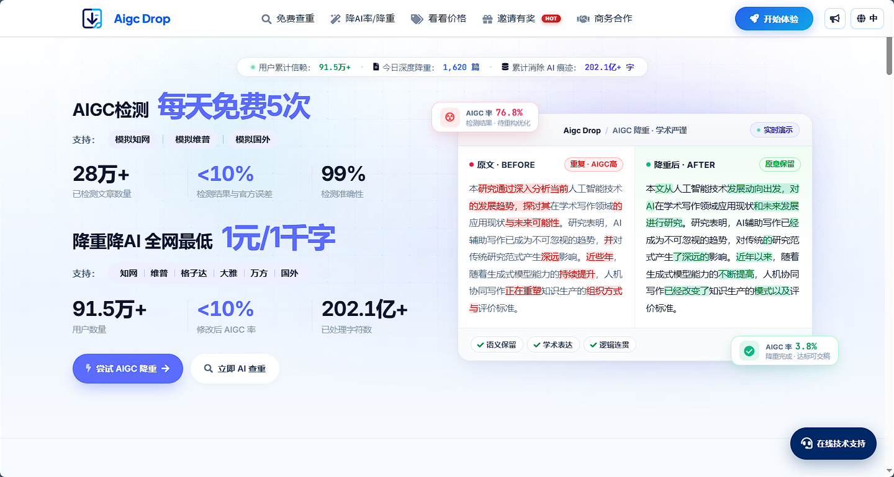
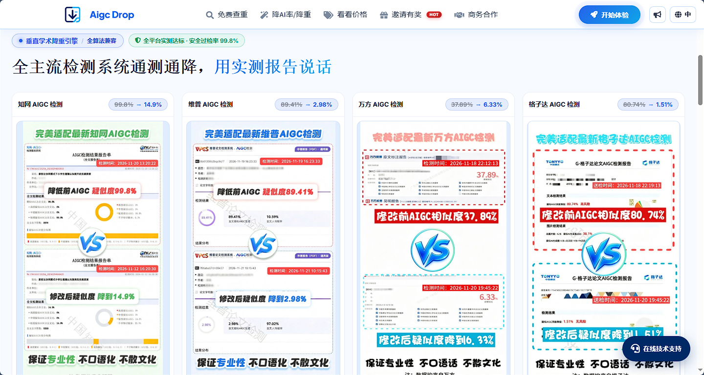
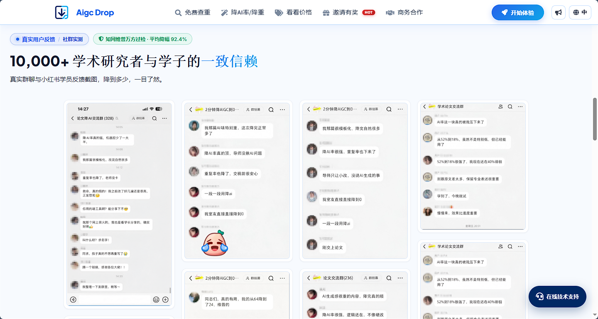
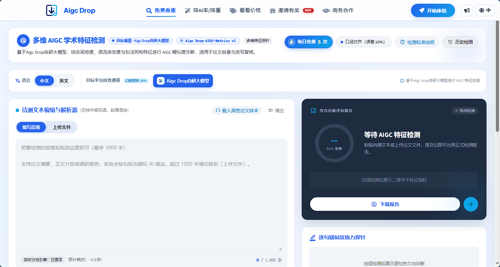
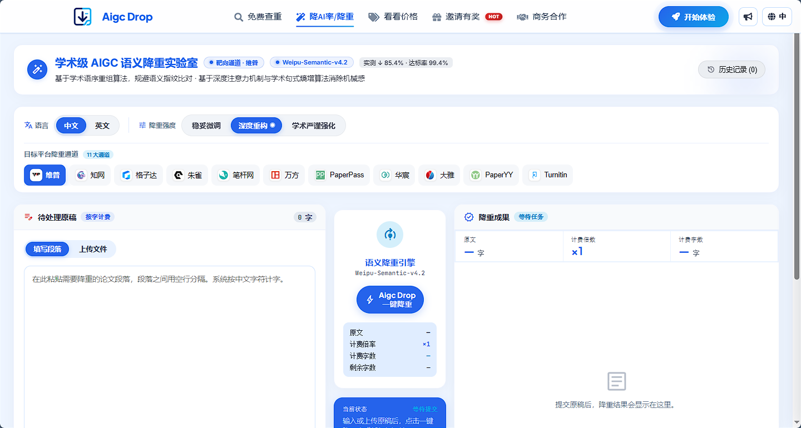
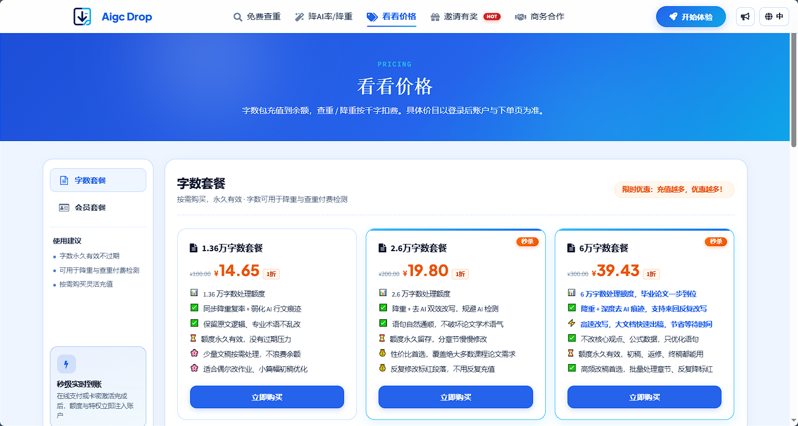
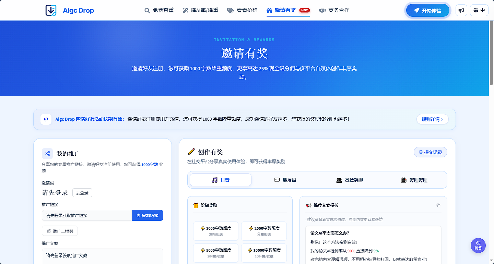
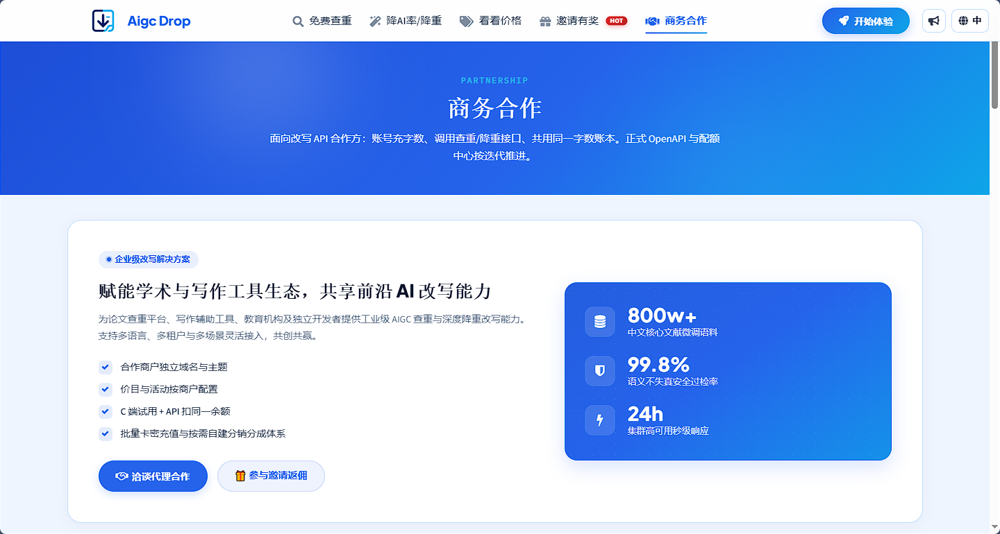
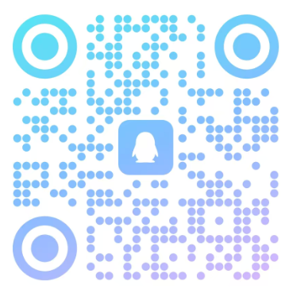

  

    
    
    
    
  

  

    <a href="https://www.aigcdrop.cn">官方网站</a>
    · <a href="https://www.aigcdrop.cn/reduceAigc">AIGC检测</a>
    · <a href="https://www.aigcdrop.cn/reduceWeight">降重改写</a>
    · <a href="https://www.aigcdrop.cn/pricing">套餐定价</a>
    · <a href="https://www.aigcdrop.cn/invite">邀请有礼</a>
    · <a href="#主要功能">功能总览</a>
  

  

    <b>AIGC Drop · 论文降 AIGC / 降重工具站：</b>专为毕业论文、课程作业打造的「检测 + 降重」垂类工具。上传文稿即可自查 AI 痕迹，再一键语义改写，尽量保留原意与专业术语。
  

  

    ✨ 按字计费，低至 <b>1 元 / 千字</b>，下单前可见估价，适合单点「降 AI」需求 
    🌐 立即体验：<a href="https://www.aigcdrop.cn"><b>https://www.aigcdrop.cn</b></a>
  

   

   
---

# 官网直达入口 · <https://www.aigcdrop.cn>

**三大主流检测平台报告对比**

首页直观对比主流检测口径下的报告差异，帮助理解「查」与「降」该怎么配合使用：

**用户口碑与实测反馈**

真实使用反馈，方便快速了解产品效果与口碑：

# 主要功能

只做查重与降重，链路更短、上手更快：

* **论文 AIGC 检测**：多维学术特征自查，提交前了解 AI 痕迹分布
* **语义降重 / 降 AIGC 率**：按段落优化高相似、高 AI 痕迹表述，尽量保留研究原意
* **论文润色式改写**：面向需要再润色的段落做语义级优化，便于人工复核后提交
* **按字计费套餐**：低至 **1 元 / 千字**，字数包充值，下单前可见估价，用多少买多少
* **邀请有礼**：邀请好友注册，双方可获得写作 / 改写额度（以活动规则为准）
* **个人中心**：余额、订单、使用记录一站可查
* **多端自适应**：PC / 平板 / 手机均可访问

> 检测与降重结果仅供参考，不替代学校或机构的正式检测结论。请以知网、维普等官方平台报告为准。

---

## 核心能力

### 🔥论文 AIGC 检测（提交前自查）

多维 AIGC 学术特征诊断，辅助了解文稿中的 AI 痕迹分布：

* 面向毕业论文、课程作业的提交前自查场景
* 段落级疑似度参考，便于定位需要优化的章节
* 结果仅供参考，正式结论以学校指定检测平台为准

直达入口：[立即免费检测](https://www.aigcdrop.cn/reduceAigc)

### 🔥🔥🔥降重 / 降 AIGC 率（语义改写）

语义级智能改写，尽量保留论文研究原意，拒绝简单同义词堆砌：

* 降低重复表述与 AI 痕迹风险，适配常见检测口径下的自查闭环
* 支持上传原稿直接优化，输出可继续编辑的优化稿
* 专业术语与结构尽量锁定，便于人工复核后提交
* 低至 **1 元 / 千字**，下单前可见估价，按字计费更透明

操作步骤：

1. 上传论文原稿 / 粘贴待优化段落
2. AI 语义级改写（降重 / 降 AIGC）
3. 在线核对后导出优化稿

直达入口：[立即开始降重](https://www.aigcdrop.cn/reduceWeight)

### 套餐定价

字数包 / 充值套餐，按需购买，低至 **1 元 / 千字**，适合单篇作业到整篇毕业论文的不同用量：

直达入口：[查看套餐](https://www.aigcdrop.cn/pricing)

### 邀请有礼

邀请好友注册，双方可获得额度奖励（以站内活动规则为准），多邀多得：

直达入口：[去邀请](https://www.aigcdrop.cn/invite)

### 商务合作

面向机构与开发者开放 API / 独立站点 / 代理分销合作，详情可联系客服洽谈：

直达入口：[商务合作](https://www.aigcdrop.cn/partner)

### 个人中心

余额、订单、使用记录集中管理，方便随时查看消费与剩余额度：

---

## 使用流程

零门槛上手，无需提示词功底：

1. **自查**：打开 [AIGC 检测](https://www.aigcdrop.cn/reduceAigc)，上传文稿了解 AI 痕迹分布
2. **降重**：进入 [降重改写](https://www.aigcdrop.cn/reduceWeight)，按估价确认后启动语义优化
3. **复核**：在线核对优化稿，必要时局部再改
4. **导出**：下载终稿，再以学校指定平台做正式检测

---

# 官网直达入口 · <https://www.aigcdrop.cn>

| 功能 | 直达链接 |
|------|----------|
| 首页 | <https://www.aigcdrop.cn> |
| 免费 AIGC 检测 | <https://www.aigcdrop.cn/reduceAigc> |
| 降重 / 降 AIGC | <https://www.aigcdrop.cn/reduceWeight> |
| 套餐定价 | <https://www.aigcdrop.cn/pricing> |
| 邀请有礼 | <https://www.aigcdrop.cn/invite> |
| 商务合作 | <https://www.aigcdrop.cn/partner> |
| 个人中心 | <https://www.aigcdrop.cn/user> |

---

# 客服与支持

* 服务时间：7×24 小时在线服务
* 客服Q号：`1183407709`
* 服务范围：AIGC 检测使用指导、降重 / 降 AIGC 辅助、充值套餐、账号问题、商务合作 / API 洽谈

