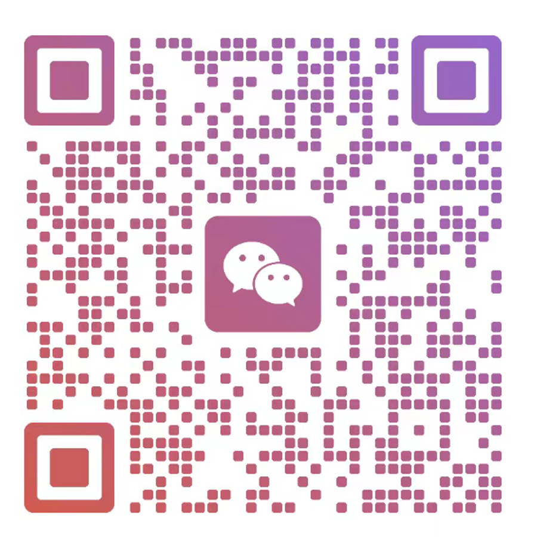
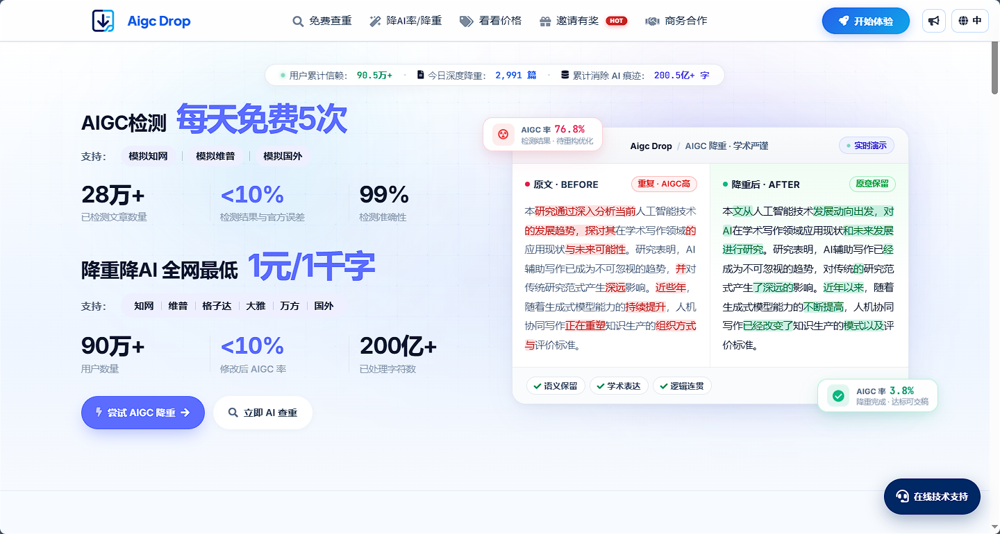
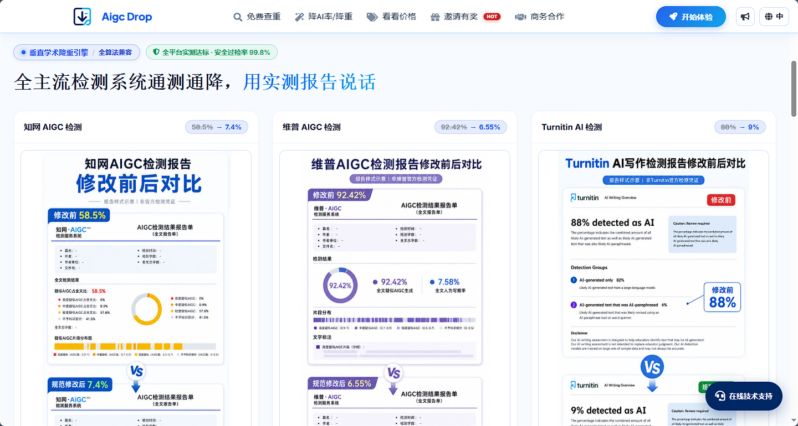
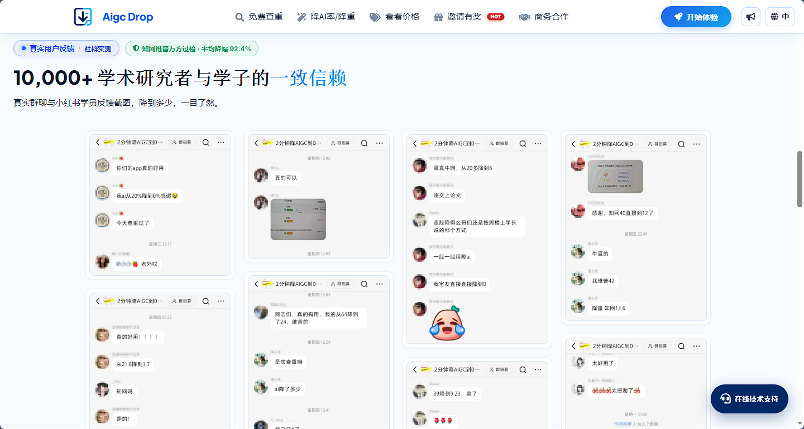
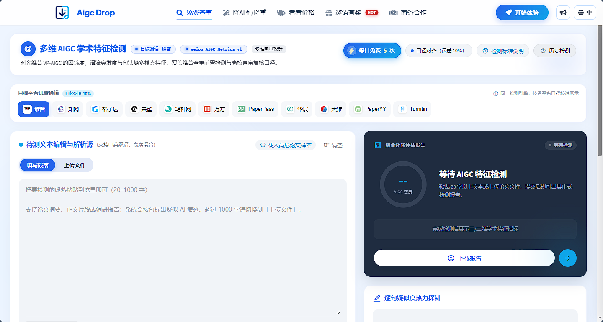
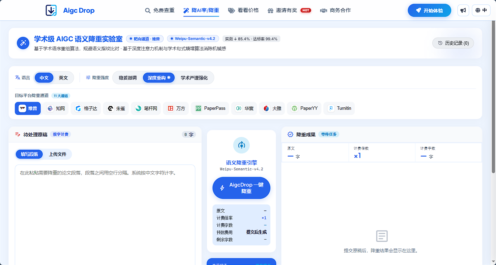
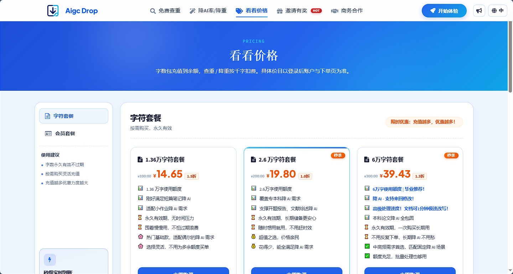
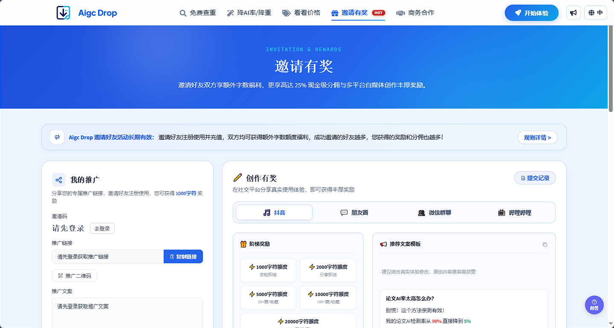
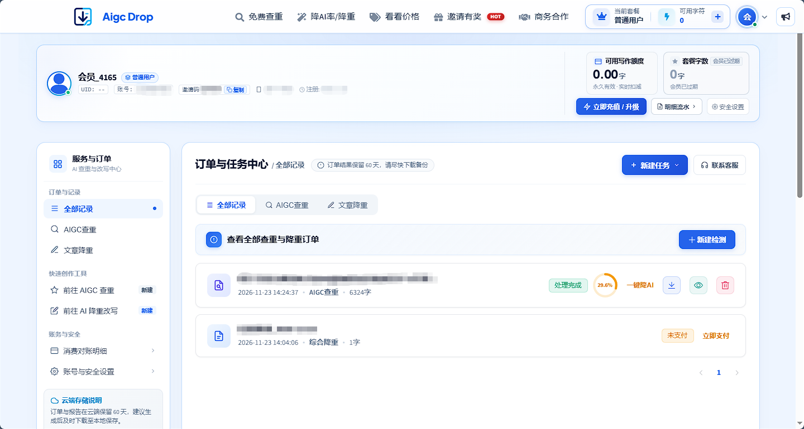

  <h1>🔬 AIGC Drop · 论文 AIGC / 降 AIGC 率工具站</h1>
  
<b>论文 AIGC 检测 · 论文润色 · 降 AIGC 率 · AIGC 降重工具 · AIGC 工具包</b>

  
🌐 在线体验：<a href="https://www.aigcdrop.cn" target="_blank"><b>www.aigcdrop.cn</b></a>

  
面向教培机构、流量主、创业者的 <b>OEM 白标 / 改写合作加盟</b> 方案：独立品牌上线、按字计费套餐、商务 API，专注「查重 + 降重」垂类获客。

   
  <h3>💥💥💥 一键免费部署 OEM 改写站</h3>
  
联系客服快速开通垂类 AIGC 工具包站点

  
<b>客服微信：mclarn0707</b>

  

    
  

---

# 在线体验地址：<a href="https://www.aigcdrop.cn" target="_blank"><b>www.aigcdrop.cn</b></a>

## 系统截图

### 首页

> 首页为垂类营销长页，自上而下覆盖检测入口、降重演示、报告对比、口碑、价值主张与商务合作：

**首屏 · AIGC 检测 + 降重工作台**

**三大主流检测平台报告对比**

**用户口碑与实测反馈**

### 💥AIGC 检测（论文 AIGC 自查）

### 💥💥💥降重 / 降 AIGC 率（AIGC 降重工具）

### 套餐定价

### 合作加盟

### 邀请分销

### 个人中心

---

### 功能特性

- 支持 **论文 AIGC 检测**：多维特征自查，辅助提交前了解 AI 痕迹分布
- 支持 **降 AIGC 率 / 语义降重**：按字计费的 AIGC 降重工具，尽量保留原意与术语
- 支持 **论文润色式改写**：面向高相似 / 高 AI 痕迹段落做语义级优化
- 支持 **AIGC 工具包** 闭环：检测 → 降重 → 充值套餐 → 订单记录
- 支持普通降重、AIGC 降重与综合方案，下单前可见估价
- 支持会员体系、字数包 / 卡密、充值与使用记录
- 支持邀请分销与提现（按租户开关）
- 支持 Web 多端自适应，便于社媒投放与私域转化
- 支持 **商务 API / 批量调用**（按合作方案开通）
- 支持 **OEM 白标**：一份产物多域名，独立品牌对外运营

**不做全流程写作菜单膨胀——只做查重与降重，转化链路更短**

---

## 能力一览

### 论文 AIGC / 检测

- 多维 AIGC 学术特征诊断
- 段落级疑似度参考与报告方向
- 面向毕业论文、课程作业提交前自查
- 结果仅供参考，不替代学校或机构正式检测结论

### AIGC 降重工具 / 论文润色

- **语义降重**：降低重复表述与 AI 痕迹风险
- **按字计费**：下单前可见估价，适合单点「降 AI」需求
- **可继续编辑**：输出优化稿，便于人工复核后提交
- 适配知网 / 维普等常见检测口径场景的自查闭环（以正式平台报告为准）

### AIGC 工具包（站点能力）

| 模块 | 路由 | 说明 |
|------|------|------|
| 首页获客 | `/` | Hero 演示、报告对比、口碑、合作转化 |
| AIGC 检测 | `/reduceAigc` | 论文 AIGC 自查 |
| 降重改写 | `/reduceWeight` | 降 AIGC 率 / 语义降重 |
| 套餐定价 | `/pricing` | 字数包与充值 |
| 合作加盟 | `/partner` | OEM / API |
| 邀请分销 | `/invite` | 代理邀请（可开关） |
| 个人中心 | `/user` | 余额、订单、记录 |

---

## 系统特性

### 💥 💥💥OEM / 改写合作加盟

- 拥有自有品牌对外展示（多租户 Host → 主题包）
- 支持个性化样式与 Theme Pack（如薄雾 `rewrite-mist`）
- 灵活使用 SAAS / 独立部署方案
- 灵活的套餐定价与按字价格体系
- 支持渠道合作、邀请分销与代理拓展
- 用户、订单、使用日志可追踪
- 一站式运维，专注获客与「降 AI」投放转化
- 提供基础资料即可启动合作部署

### 多端与交付形态

- **Web**：AIGC 检测与降重主入口
- **自适应**：PC / 平板 / 手机均可访问
- **可扩展**：按合作方案开放商务 API / 批量处理

### 合作价值

- 成熟垂类产品，缩短从 0 到 1 的上线周期
- 覆盖「检 → 降 → 充 → 复购」短转化链路，适合社媒「降 AI」单点流量
- 适合教培、代理、私域、内容流量等多类商户模式
- 与全流程写作主站分层获客，菜单更轻、转化更聚焦

## 联系商务 / 加盟合作

欢迎教培机构、代理商、流量主、创业团队洽谈 **OEM 白标 / 改写合作加盟**。

- 在线体验：<a href="https://www.aigcdrop.cn" target="_blank">www.aigcdrop.cn</a>
- 商务微信：mclarn0707
- 客服二维码：

---

# 在线体验地址：<a href="https://www.aigcdrop.cn" target="_blank"><b>www.aigcdrop.cn</b></a>
